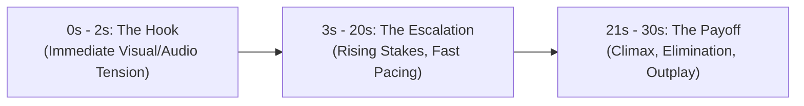

# What Makes a Clip Hold Attention: Hooks, Pacing & Length

On short-form mobile video platforms (YouTube Shorts, Instagram Reels, TikTok), viewers scroll with their thumbs. You have less than **2.0 seconds** before a viewer swipes to the next video.

Understanding visual pacing and narrative structure will dramatically improve your clip completion rates.

---

## 1. The Anatomy of an Attention-Holding Gameplay Clip

A high-retention gameplay clip follows a three-act structure compressed into 25–35 seconds:

### Act 1: The Hook (0s - 2s)
- **Zero Intro Screens:** Do not show 5 seconds of your channel logo, spinning intro graphics, or silence.
- **Start with Motion or Sound:** Start immediately in the middle of movement—driving fast, scoped into a sniper rifle, or shouting callouts during a gunfight.
- **Establish the Stake:** Let the viewer see immediately what is at risk (e.g. 1 HP remaining, 5 seconds left on the bomb, 1v4 clutch situation).

### Act 2: The Escalation (3s - 20s)
- Keep action moving. If there are 8 seconds of running across an empty field with nothing happening, trim it out.
- Ensure audio clarity: in-game gunshots, footsteps, or crisp reactions build natural anticipation.

### Act 3: The Payoff (21s - 30s)
- Deliver the promised resolution cleanly.
- End promptly after the climax. Lingering for 10 seconds of scoreboard staring after the play destroys retention charts.

---

## 2. The Ideal Length: Why 15–45 Seconds Wins

Why does ClipLane set its highlight window bounds between **15 and 45 seconds**?

- **Under 15 Seconds:** Often too brief for the viewer to comprehend what game is being played or understand the skill involved.
- **15 to 30 Seconds:** The highest completion-rate bracket on vertical video feeds. A viewer who watches a 25-second clip to the end yields 100% average percentage viewed (APV).
- **Over 45–60 Seconds:** Requires substantial editing, multiple camera perspectives, or high-level spoken storytelling to avoid drop-off mid-video.

---

## 3. Trimming Dead Air Without Clickbait

There is a major difference between **pacing** and **clickbait**:

| Good Pacing (Recommended) | Misleading Clickbait (Avoid) |
| :--- | :--- |
| Starting 2 seconds before the action begins so the setup is clear | Using an unrelated shock thumbnail that never happens in the clip |
| Trimming prolonged loading screens or quiet inventory management | Putting "YOU WON'T BELIEVE WHAT HAPPENED" on a routine elimination |
| Keeping honest in-game audio and genuine player excitement | Faking audio reactions or adding artificial canned laughter |

> [!NOTE]
> Truthful, skillful gameplay builds long-term creator credibility. Misleading hooks cause immediate viewer swipes and negative signals to recommendation engines.
